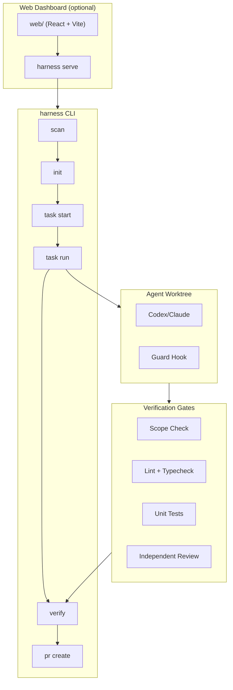

[](https://github.com/Quattro-Commas/harness/actions/workflows/harness.yml)
[](https://pypi.org/project/harness-agent2/)
[](https://www.gnu.org/licenses/agpl-3.0)
[](https://www.python.org/downloads/)

# Harness

Local-first control plane that turns a normal Git repo into a governed, verifiable
agentic dev environment. Agents that run through Harness complete tasks with
measurably higher accuracy because every write is scoped, every claim is gated,
and nothing ships until an independent reviewer passes it.

## The problem

AI coding agents produce plausible-looking code that passes CI but violates
scope, skips edge cases, and claims completion without evidence. Manual review
catches some of this, but doesn't scale. Harness automates the governance: it
wraps every agent task in a contract, gates every result, and blocks PRs that
fail verification.

## Quick start

```bash
uv tool install harness-agent2     # or: uv tool install --editable .
harness scan                       # agent-readiness score
harness init                       # set up .ai-engineering/ config
harness task start my-task --goal "Add feature X" --accept "works" --risk medium
harness task run my-task           # run agent in worktree
harness verify my-task             # gates + evidence
```

## Commands

```
harness scan                       # agent-readiness score, detected gates, protected paths
harness scan --fail-under 70       # CI floor: exits 1 when readiness is below N
harness init                       # writes .ai-engineering/{project,policy,verification}.json,
                                   # CLAUDE.md + AGENTS.md, .claude/settings.json
harness ci                         # writes .github/workflows/harness.yml
harness policy push <bundle-repo>  # publish policy to shared Git repo
harness policy status <bundle-repo>  # exits 1 when local differs from team
harness task start invites --goal "Add team invitations" --accept "expired invite is rejected" --risk high
harness task update invites --allow "src/**" --allow "tests/**"
harness task list                  # contracts with risk, branch, latest verdict
harness task run invites --agent codex  # headless agent (claude|codex)
harness verify invites             # gates + scope check + review -> evidence HTML
harness pr create invites          # refuses unless evidence verdict is PASS
harness serve --port 8766          # local API + dashboard backend
harness eval run --agent codex     # raw-vs-harnessed eval corpus
```

## Architecture



Harness wraps every agent task in a contract. The agent works in an isolated
worktree with scope restrictions enforced by the guard hook. When it reports
completion, Harness runs every gate for the task's risk level, checks that
changes stayed in scope, and runs an independent review. Only when all three
pass does it allow a PR to be created.

## Key design decisions

- **Completion contract**: a task is done only when all gates for its risk level
  pass, changes stay in scope, and the reviewer returns `VERDICT: PASS`.
- **Guard hook**: `harness guard` is a Claude Code PreToolUse hook that blocks
  writes to protected paths, reads of secrets, and forbidden commands.
- **Plain JSON/Markdown in Git**: no databases, no lock-in. Inspect everything
  with `git diff`.
- **Local-first**: the CLI is fully usable without the dashboard. `harness serve`
  adds a web UI and API on `127.0.0.1:8766`.
- **Stdlib-only core**: Python standard library only for the core pipeline. Web
  dashboard is separate (React + Vite).

## Tests

```bash
uv run pytest -q                    # unit tests
uv run ruff check .                 # lint
uv run mypy harness/                # type check
cd web && npx playwright test       # e2e dashboard tests
```

## Evals

6 small tasks (3 Python, 3 TypeScript) each run twice — raw agent call vs. the
full pipeline, same agent binary. Ground truth is a hidden acceptance suite the
agent never sees. Live matrix (codex, 2026-09-30, 13 runs): **11/13 graded
PASS** — only slugify failed on the collapse-runs edge case.

Regenerate with:
```bash
harness eval run --agent all && harness eval report
```

## Limitations

- **Agent-dependent**: quality depends on the underlying agent. Harness governs
  the process but can't fix a weak model.
- **Provider session limits**: independent review may hit API rate limits on
  first pass. Recorded, not skipped.
- **No hosted product yet**: local-only. Review Agent SDK commercial terms
  before shipping a hosted version.
- **Claude quota window**: the claude agent half waits on the 07:00 (Brussels)
  quota window for eval runs.

## License and network source (AGPL §13)

`harness-agent` is **AGPL-3.0-only** — see [`LICENSE`](LICENSE).

Exactly one command opens a socket: `harness serve`. It runs FastAPI on
`127.0.0.1:8766` by default (`--host` / `--port`) and authenticates
state-changing requests with the bearer token in `.ai-engineering/serve.token`.
Every other command is a local CLI that reads and writes files and never listens.

If you rebind `--host` away from loopback, or forward the port so someone else
can reach the API or the dashboard, remote users are interacting with your
build over a network and AGPL §13 applies. You must then offer those users the
Corresponding Source of *your* version from a network server at no charge.

The Corresponding Source for this work is public at no charge here:

    https://github.com/Quattro-Commas/harness

Check out the commit you built from on `main` to reproduce it exactly.
